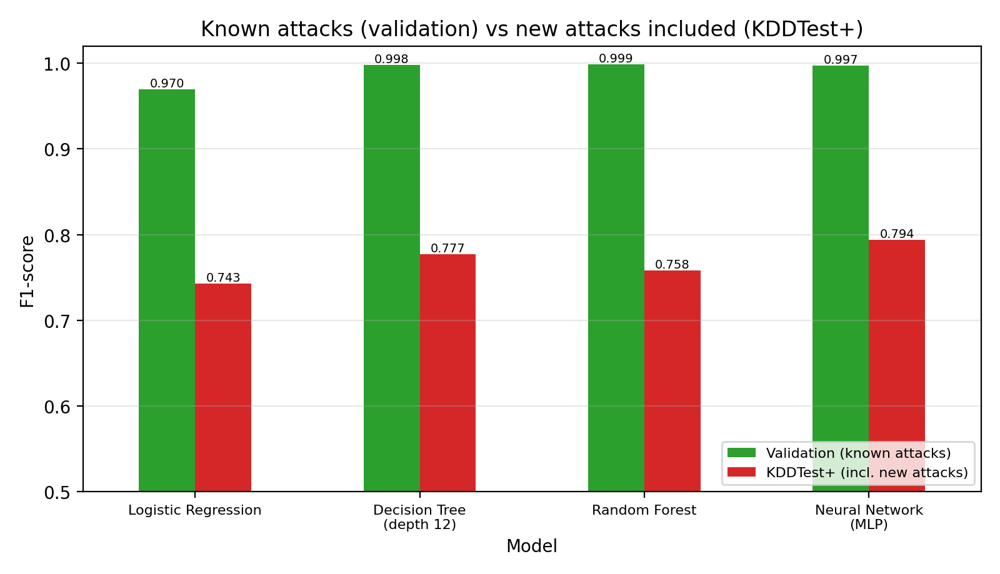
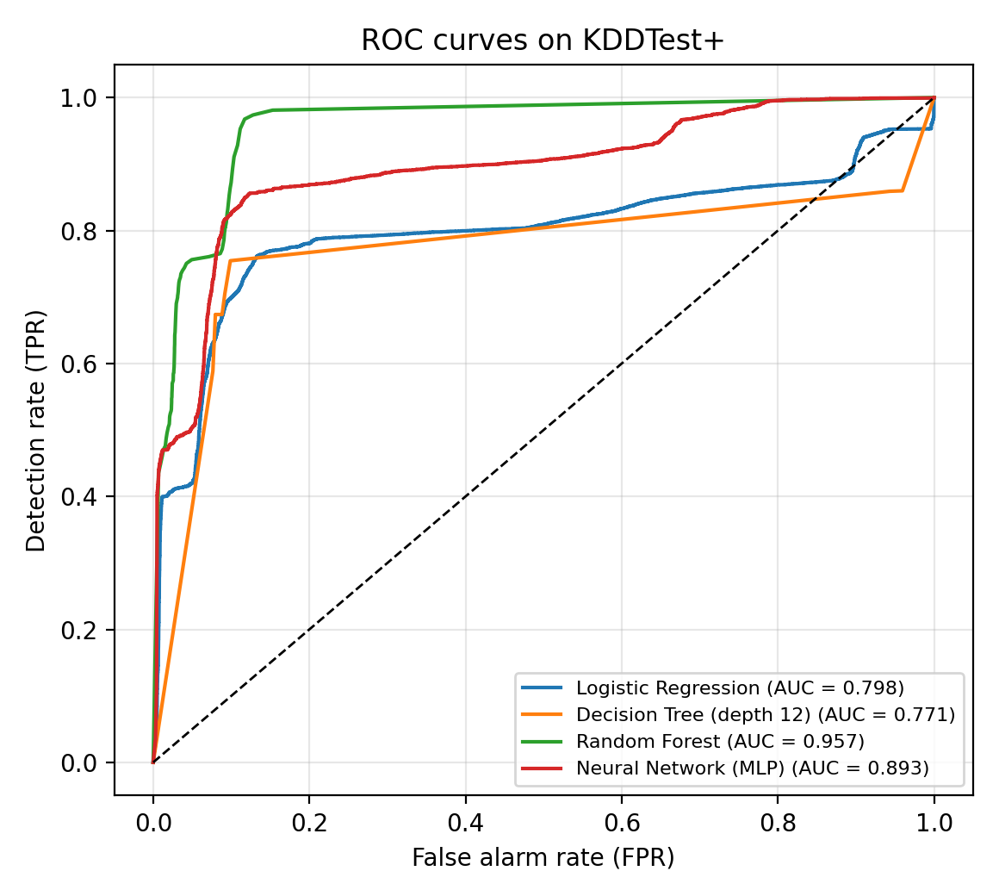
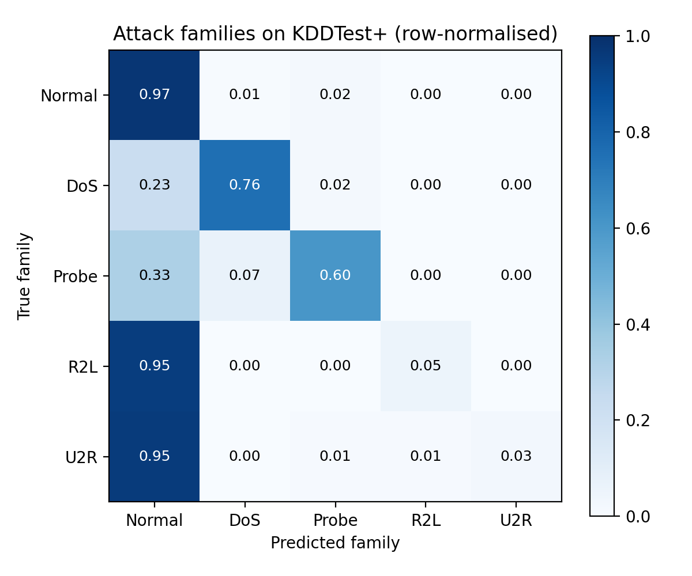

# Machine-Learning Intrusion Detection for IoT Gateways

[](https://colab.research.google.com/github/<your-username>/iot-intrusion-detection-ml/blob/main/intrusion_detection.ipynb)

Lightweight ML intrusion-detection models (Normal vs Attack, and attack family) evaluated
**honestly** on the NSL-KDD benchmark — including attack types never seen during training.

**Author:** Mohammad Nafees, Ph.D. Scholar (ECE), MNNIT Allahabad

---

## 1. Problem

IoT devices cannot protect themselves, so attacks are usually caught at the **gateway / edge**
by an Intrusion Detection System (IDS). Each network connection has 41 features (duration,
protocol, service, bytes, error rates, …). The IDS must decide **Normal or Attack**, and the
attack family: **DoS, Probe, R2L** (remote-to-local) or **U2R** (user-to-root).

## 2. Dataset

[NSL-KDD](https://www.unb.ca/cic/datasets/nsl.html) (Canadian Institute for Cybersecurity, UNB) —
a cleaned version of KDD Cup 99, downloaded automatically by the script.

| File | Connections | Note |
|---|---:|---|
| KDDTrain+ | 125,973 | 22 attack types |
| KDDTest+ | 22,544 | contains **17 attack types that never appear in training** |

> NSL-KDD is a general network-traffic benchmark widely used to develop lightweight IDS models for
> IoT gateways; it was not captured from IoT devices. Validation on IoT-specific datasets
> (e.g. CIC-IoT2023, TON_IoT) is planned future work.

## 3. Method

- One-hot encoding (protocol, service, flag) + standard scaling (numeric features) → 122 inputs.
- Four classifiers: Logistic Regression, Decision Tree (depth 12, edge-friendly), Random Forest, Neural Network (MLP 64-32).
- Two evaluations: a 20 % hold-out of the training file (**known** attack types) and the official **KDDTest+** (includes **new** attack types).

## 4. Results — binary detection

| Model | F1 (known attacks) | Accuracy (KDDTest+) | F1 (KDDTest+) | Detection rate | False alarm rate | ROC-AUC | Size (KB) |
|---|---:|---:|---:|---:|---:|---:|---:|
| Logistic Regression | 0.970 | 0.754 | 0.743 | 0.624 | 0.075 | 0.798 | 6 |
| Decision Tree (depth 12) | 0.998 | 0.780 | 0.777 | 0.674 | 0.080 | 0.771 | 25 |
| Random Forest | 0.999 | 0.774 | 0.758 | 0.623 | 0.027 | 0.957 | 8,298 |
| Neural Network (MLP) | 0.997 | 0.795 | 0.794 | 0.695 | 0.072 | 0.893 | 246 |



**Key findings**

- Every model scores **F1 ≈ 0.97–0.999 on known attacks but only ≈ 0.74–0.79 on KDDTest+** — a
  classic generalisation gap. Reporting only a random split would overstate real-world performance.
- Random Forest detects **76.8 %** of test attacks whose type was seen in training, but only
  **25.7 %** of attacks of completely new types.
- Random Forest has the lowest false-alarm rate (2.7 %) and the best ranking ability (AUC 0.957);
  its ROC shows **87 % detection at a 10 % false-alarm rate** (analysis only, threshold not tuned on test).
- For constrained gateways, the **25 KB decision tree** reaches F1 0.777 vs 0.758 for the 8 MB random forest.



## 5. Results — attack family (Random Forest, KDDTest+, accuracy 74.1 %)

| Family | Test samples | Recall |
|---|---:|---:|
| Normal | 9,711 | 97.3 % |
| DoS | 7,458 | 75.7 % |
| Probe | 2,421 | 60.5 % |
| R2L | 2,754 | 5.1 % |
| U2R | 200 | 2.5 % |

R2L and U2R are rare in training (995 and 52 samples) and mostly new types in the test set, so they
are almost always missed — the main weakness to fix (class re-weighting, oversampling, anomaly detection).



More: [binary confusion matrix](results/confusion_matrix_binary.png) · [feature importance](results/feature_importance.png) ·
[all metrics](results/binary_detection_results.csv)

## 6. How to run

```bash
git clone https://github.com/<your-username>/iot-intrusion-detection-ml.git
cd iot-intrusion-detection-ml
pip install -r requirements.txt
python intrusion_detection.py      # downloads NSL-KDD (≈ 22 MB) on first run
```

Or open `intrusion_detection.ipynb` in Google Colab → **Runtime → Run all** (≈ 2 minutes).

## License

Code: MIT. Dataset: NSL-KDD, © Canadian Institute for Cybersecurity — see its original terms.
